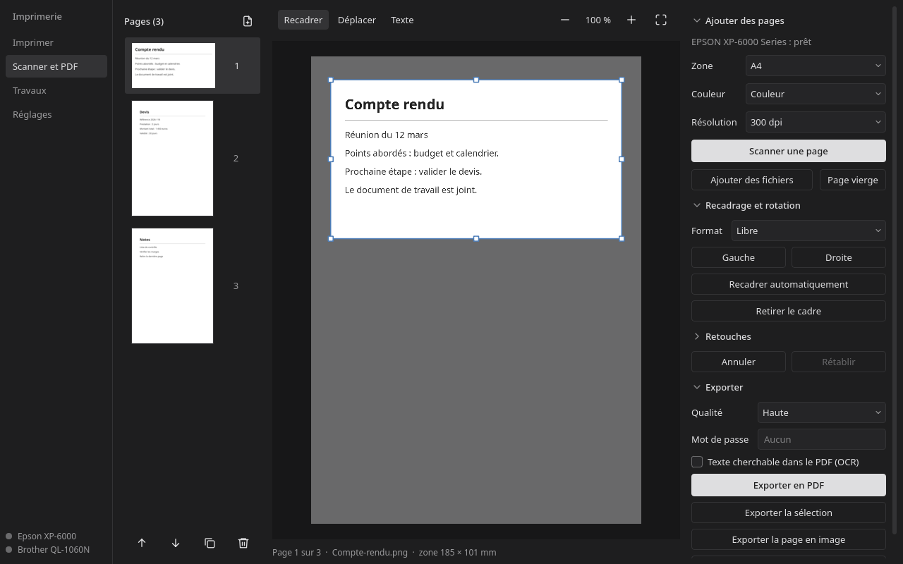
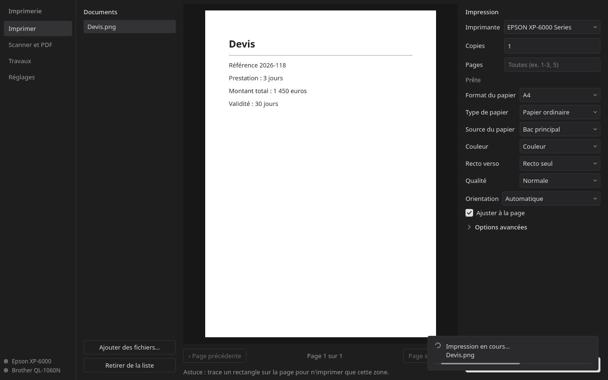
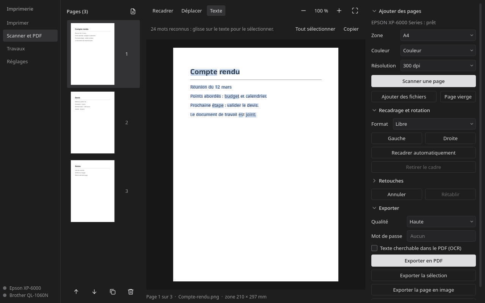
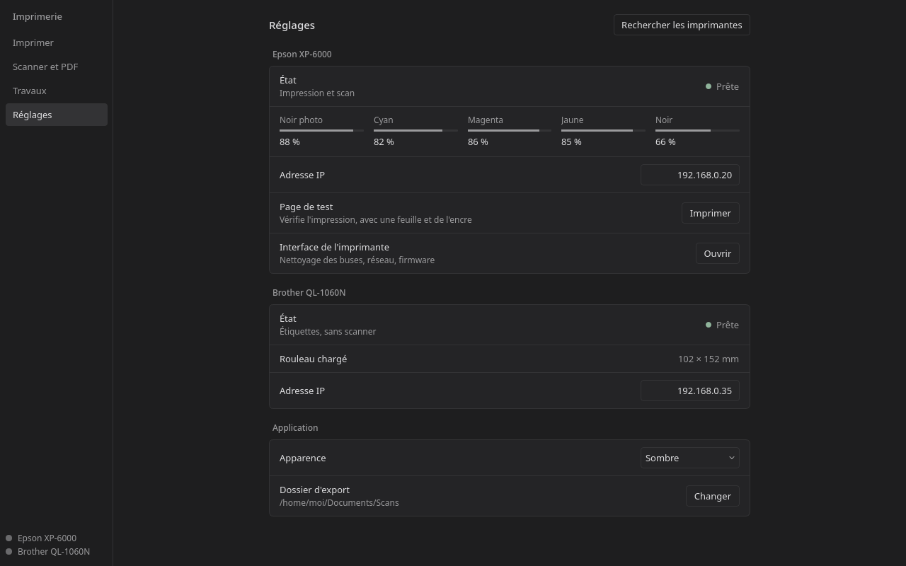
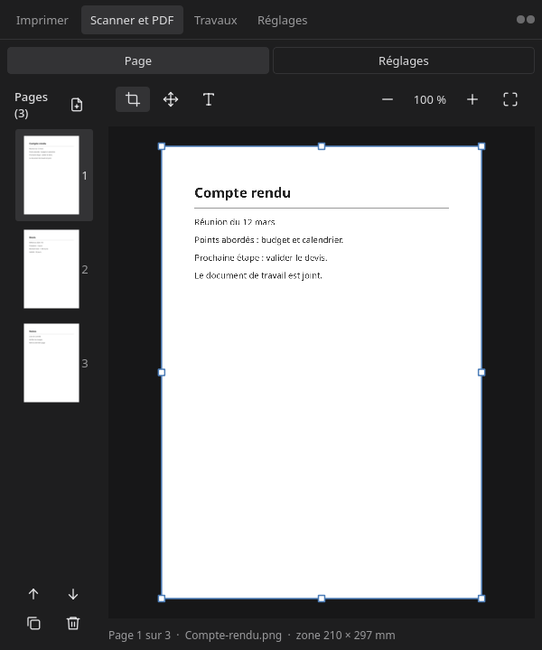

# Imprimerie

Application de bureau pour imprimer, scanner et assembler des documents sous Linux, sans passer
par les logiciels des fabricants. Écrite en Python avec Qt 6, elle est pensée pour un usage
quotidien sur le réseau local.

Elle a été développée et testée avec une **Epson XP-6000** et une **Brother QL-1060N**. D'autres
imprimantes CUPS apparaissent dans la liste, sans avoir été essayées. Le scan et les étiquettes
sont propres à ces deux modèles.



## Fonctionnalités

### Imprimer
- PDF, images et texte par glisser-déposer, et formats Office si LibreOffice est installé
- Aperçu page par page, et impression d'une zone tracée à la souris
- Format, type de papier, couleur, recto verso et qualité, selon ce que propose l'imprimante
- Plusieurs pages par feuille, pages paires ou impaires, échelle, ordre inversé, miroir
- Suivi du travail jusqu'à sa fin, et liste des travaux

### Scanner et assembler
- Chaque scan ajoute une page en bas de la liste, comme une diapositive
- Fusion de scans, de PDF et d'images ; pages à réordonner, dupliquer ou supprimer
- Recadrage à la souris, formats A4, A5, A6 et Lettre, recadrage automatique des bords
- Rotation, redressement, luminosité, contraste, rendus document, gris, noir et blanc
- Zoom qui reste net, et texte sélectionnable, y compris sur un scan grâce à l'OCR
- Export PDF de tout ou de la sélection : qualité, mot de passe, texte cherchable
- Annuler et rétablir ; les pages sont conservées d'un lancement à l'autre

### Étiquettes
- Impression directe sur la Brother QL-1060N, avec une zone du document mise à l'échelle
- Aperçu du résultat en noir et blanc, et refus si le rouleau chargé ne correspond pas

### Interface
- Thèmes sombre et clair, sobres
- S'adapte à la largeur de la fenêtre, y compris en vue partagée
- Recherche des imprimantes sur le réseau si leur adresse change

## Captures

| Impression | Texte sélectionnable |
|---|---|
|  |  |

| Réglages | Fenêtre étroite |
|---|---|
|  |  |

## Installation

Testée sous Arch Linux, avec Hyprland. Sur Arch :

```sh
sudo pacman -S pyside6 python-pillow python-numpy python-pycups python-pypdf \
               cups poppler net-snmp sane
```

Le scan demande aussi le pilote `epsonscan2`. En option : `tesseract` et `tesseract-data-fra` pour
le texte sélectionnable et l'OCR, `libreoffice-fresh` pour les formats Office.

```sh
git clone https://github.com/freezer71/imprimerie.git
cd imprimerie
./install.sh
imprimerie
```

`install.sh` ajoute la commande `imprimerie` et une entrée de menu pour l'utilisateur courant, sans
droits root. L'application utilise les paquets Python du système. Le dossier cloné doit rester en
place.

## Configuration

Les adresses des imprimantes se règlent dans **Réglages**, ou avec **Rechercher les imprimantes**.

| Élément | Emplacement |
|---|---|
| Réglages | `~/.config/imprimerie/config.json` |
| Pages et scans en cours | `~/.local/share/imprimerie/session`, jusqu'à « Nouveau document » |
| Exports | `~/Documents/Scans` par défaut |

## Raccourcis

| Touche | Action |
|---|---|
| `F5` | Scanner une page |
| `Ctrl+O` | Ajouter des fichiers |
| Molette, `Ctrl++`, `Ctrl+-` | Zoomer, dézoomer |
| `Ctrl+0` | Voir toute la page |
| Bouton du milieu | Se déplacer dans la page |
| `Ctrl+Z`, `Ctrl+Maj+Z` | Annuler, rétablir |
| `Ctrl+C` | Copier le texte sélectionné |
| `Suppr` | Supprimer les pages sélectionnées |

## Limites connues

- **Recadrer ne supprime pas :** sur une page de PDF, le contenu masqué reste dans le fichier. Pour
  retirer une information sensible, exporte avec l'OCR : les pages deviennent des images.
- **OCR :** la reconnaissance peut se tromper, relis le texte important.
- **Pas un pilote système :** la Brother n'apparaît pas dans la boîte d'impression des autres
  logiciels, et l'application s'adresse directement à elle.
- **Scan :** il passe par la vitre uniquement. Un message affiché sur l'écran de l'imprimante, comme
  une proposition de mise à jour, peut le bloquer jusqu'à sa fermeture.
- **Encore à valider sur le matériel :** les étiquettes Brother, le suivi d'impression et les options
  avancées d'impression n'ont été testés qu'en simulation.

## Développement

```sh
QT_QPA_PLATFORM=offscreen /usr/bin/python3 -m unittest discover -s tests -t .
```

Les tests n'ont pas besoin d'imprimante. `tests/test_layout.py` vérifie qu'aucun contrôle ne déborde
ni ne se chevauche, de 1360 à 520 pixels de large.

| Module | Rôle |
|---|---|
| `ui.py` | Fenêtre, écrans Imprimer, Travaux et Réglages |
| `editor_ui.py`, `editor.py` | Éditeur de pages : interface et modèle |
| `printing.py`, `documents.py` | Files CUPS, ouverture et rendu des documents |
| `sane_scan.py`, `escl.py` | Scan, et lecture de l'état du scanner |
| `brother.py`, `devices.py` | Raster des étiquettes, état des imprimantes |
| `theme.py`, `widgets.py`, `icons.py` | Apparence et composants partagés |

## Remerciements

Le format d'envoi à la Brother a été écrit d'après le code source de
[brother_ql](https://github.com/pklaus/brother_ql), qui n'est pas utilisé comme dépendance.
