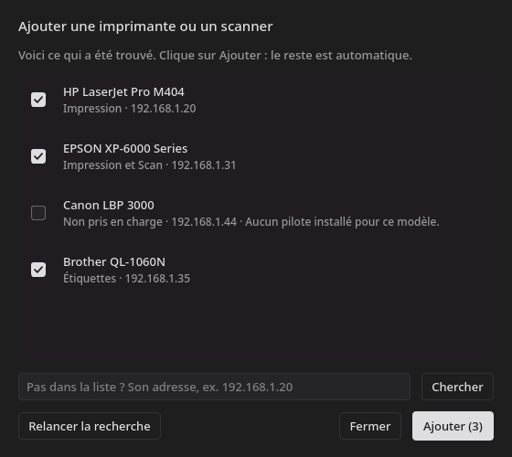

# Feuillet

Application de bureau pour imprimer, scanner et assembler des documents sous Linux, sans passer
par les logiciels des fabricants. Écrite en Python avec Qt 6, elle est pensée pour un usage
quotidien sur le réseau local.

Elle a été développée et testée avec une **Epson XP-6000** et une **Brother QL-1060N**. D'autres
imprimantes CUPS apparaissent dans la liste, sans avoir été essayées. Le scan et les étiquettes
sont propres à ces deux modèles.


## Fonctionnalités

### Imprimer
- PDF, images et texte par glisser-déposer, et formats Office si LibreOffice est installé
- Aperçu page par page, et impression d'une zone tracée à la souris
- Format, type de papier, couleur, recto verso et qualité, selon ce que propose l'imprimante
- Plusieurs pages par feuille, pages paires ou impaires, échelle, ordre inversé, miroir
- Suivi du travail jusqu'à sa fin, et liste des travaux

### Scanner et assembler
- Chaque scan ajoute une page en bas de la liste, comme une diapositive
- Fusion de scans, de PDF et d'images ; pages à réordonner, dupliquer ou supprimer
- Recadrage à la souris, formats A4, A5, A6 et Lettre, recadrage automatique des bords
- Rotation, redressement, luminosité, contraste, rendus document, gris, noir et blanc
- Zoom qui reste net, et texte sélectionnable, y compris sur un scan grâce à l'OCR
- Export PDF de tout ou de la sélection : qualité, mot de passe, texte cherchable
- Annuler et rétablir ; les pages sont conservées d'un lancement à l'autre

### Étiquettes
- Impression directe sur la Brother QL-1060N, avec une zone du document mise à l'échelle
- Aperçu du résultat en noir et blanc, et refus si le rouleau chargé ne correspond pas

### Ajouter un appareil
- **Réglages**, **Ajouter un appareil** : l'application cherche sur le réseau et en USB
- Les imprimantes AirPrint et IPP Everywhere se configurent sans pilote, en un clic
- Les scanners réseau eSCL fonctionnent sans rien installer ; un pilote SANE présent est préféré
- Le service d'impression arrêté est activé pour toi, et le mot de passe n'est demandé que si besoin
- Une imprimante qui a changé d'adresse est reconnue, et sa configuration est conservée
- Imprimante par défaut, reprise après une erreur, page de test, retrait

### Interface
- Thèmes sombre et clair, sobres
- S'adapte à la largeur de la fenêtre, y compris en vue partagée

## Captures



| Impression | Texte sélectionnable |
|---|---|
|  |  |

| Réglages | Fenêtre étroite |
|---|---|
|  |  |

## Installation

### Le plus simple : l'installateur

Il reconnaît Arch, Debian, Ubuntu, Fedora et openSUSE, ainsi que leurs dérivées, installe ce qui
manque, puis ajoute la commande `feuillet` et une entrée de menu pour ton utilisateur.

```sh
git clone https://github.com/freezer71/feuillet.git
cd feuillet
./install.sh
feuillet
```

Seules les dépendances du système demandent le mot de passe `sudo`. Si la distribution ne fournit
pas PySide6 ou pypdf, ils sont installés à part dans `~/.local/share/feuillet/venv`, sans toucher au
système. Le dossier cloné peut ensuite être supprimé.

| Option | Effet |
|---|---|
| `--yes` | Installe les dépendances sans confirmation |
| `--no-deps` | N'installe aucun paquet du système |
| `--dev` | Lance le code du dossier cloné, pratique pour développer |

Pour tout retirer : `./uninstall.sh`. Tes réglages et tes pages en cours restent, sauf avec
`./uninstall.sh --purge`, qui efface aussi les scans non exportés.

### Avec un vrai paquet

**Arch Linux et dérivées**

```sh
cd packaging/arch
makepkg -si
```

**Debian 13 ou plus** (Ubuntu 24.04 ne fournit pas PySide6 : utilise l'installateur)

```sh
./packaging/debian/build-deb.sh
sudo apt install ./dist/feuillet_0.1.0_all.deb
```

Les paquets déjà construits se trouvent aussi dans les
[versions publiées](https://github.com/freezer71/feuillet/releases).

**Fedora** (demande `rpm-build`)

```sh
rpmbuild -bb packaging/fedora/feuillet.spec --define "_sourcedir $PWD" --define "_rpmdir $PWD/dist"
sudo dnf install dist/noarch/feuillet-*.rpm
```

### Autres distributions

Installe Python 3.12 ou plus, pycups, CUPS (`lp`, `ipptool`), Poppler, `snmpget` et SANE
(`scanimage`), puis lance `./install.sh --no-deps`. En option : Tesseract pour lire le texte des
scans, LibreOffice pour les formats Office.

### Scanner

Le scan passe par le pilote `epsonscan2`, à installer à part, car les distributions ne le
fournissent généralement pas : il se télécharge chez Epson. Sans lui, tout le reste fonctionne.

### Distributions testées

Installation depuis zéro, tests automatiques, lancement et désinstallation, dans des conteneurs :

| Distribution | Installateur | Paquet |
|---|---|---|
| Arch Linux | Oui | Oui |
| Debian 13 | Oui | Oui (`.deb`) |
| Ubuntu 24.04 | Oui | Non pris en charge |
| Fedora 43 | Oui | Oui (`.rpm`) |
| openSUSE Tumbleweed | Oui | Pas de paquet |

Ces essais ont eu lieu sans écran ni imprimante : au quotidien, l'application n'a tourné que sur Arch
avec Hyprland.

## Configuration

Les appareils s'ajoutent depuis **Réglages**, sans fichier à modifier.

Le mot de passe éventuellement demandé sert à configurer CUPS, le temps de la commande. Il passe par
`pkexec` quand un agent d'autorisation existe, sinon par `sudo`, et n'est jamais enregistré.

| Élément | Emplacement |
|---|---|
| Réglages | `~/.config/feuillet/config.json` |
| Pages et scans en cours | `~/.local/share/feuillet/session`, jusqu'à « Nouveau document » |
| Exports | `~/Documents/Scans` par défaut |

## Raccourcis

| Touche | Action |
|---|---|
| `F5` | Scanner une page |
| `Ctrl+O` | Ajouter des fichiers |
| Molette, `Ctrl++`, `Ctrl+-` | Zoomer, dézoomer |
| `Ctrl+0` | Voir toute la page |
| Bouton du milieu | Se déplacer dans la page |
| `Ctrl+Z`, `Ctrl+Maj+Z` | Annuler, rétablir |
| `Ctrl+C` | Copier le texte sélectionné |
| `Suppr` | Supprimer les pages sélectionnées |

## Limites connues

- **Recadrer ne supprime pas :** sur une page de PDF, le contenu masqué reste dans le fichier. Pour
  retirer une information sensible, exporte avec l'OCR : les pages deviennent des images.
- **OCR :** la reconnaissance peut se tromper, relis le texte important.
- **Pas un pilote système :** la Brother n'apparaît pas dans la boîte d'impression des autres
  logiciels, et l'application s'adresse directement à elle.
- **Scan :** il passe par la vitre uniquement. Un message affiché sur l'écran de l'imprimante, comme
  une proposition de mise à jour, peut le bloquer jusqu'à sa fermeture.
- **Recherche réseau :** elle couvre le réseau local en /24. Sinon, indique l'adresse de l'appareil.
- **Encore à valider sur le matériel :** les étiquettes Brother, les options avancées d'impression, les
  imprimantes USB, les scanners eSCL et l'ajout d'un appareil réel n'ont été testés qu'en simulation ou
  avec des appareils virtuels.

## Développement

```sh
QT_QPA_PLATFORM=offscreen /usr/bin/python3 -m unittest discover -s tests -t .
```

Les tests n'ont pas besoin d'imprimante. `tests/test_layout.py` vérifie qu'aucun contrôle ne déborde
ni ne se chevauche, de 1360 à 520 pixels de large.

| Module | Rôle |
|---|---|
| `ui.py` | Fenêtre, écrans Imprimer, Travaux et Réglages |
| `editor_ui.py`, `editor.py` | Éditeur de pages : interface et modèle |
| `printing.py`, `documents.py` | Files CUPS, ouverture et rendu des documents |
| `sane_scan.py`, `escl.py` | Scan via SANE ou eSCL, selon l'appareil |
| `discovery.py`, `setup_ui.py`, `admin.py` | Détection, assistant d'ajout, droits d'administrateur |
| `brother.py`, `devices.py` | Raster des étiquettes, état des imprimantes |
| `theme.py`, `widgets.py`, `icons.py` | Apparence et composants partagés |

## Licence

Feuillet est un logiciel libre, distribué sous licence [GPL-3.0](LICENSE).

## Remerciements

Le format d'envoi à la Brother a été écrit d'après le code source de
[brother_ql](https://github.com/pklaus/brother_ql), sous licence GPL-3.0, qui n'est pas utilisé comme
dépendance.
